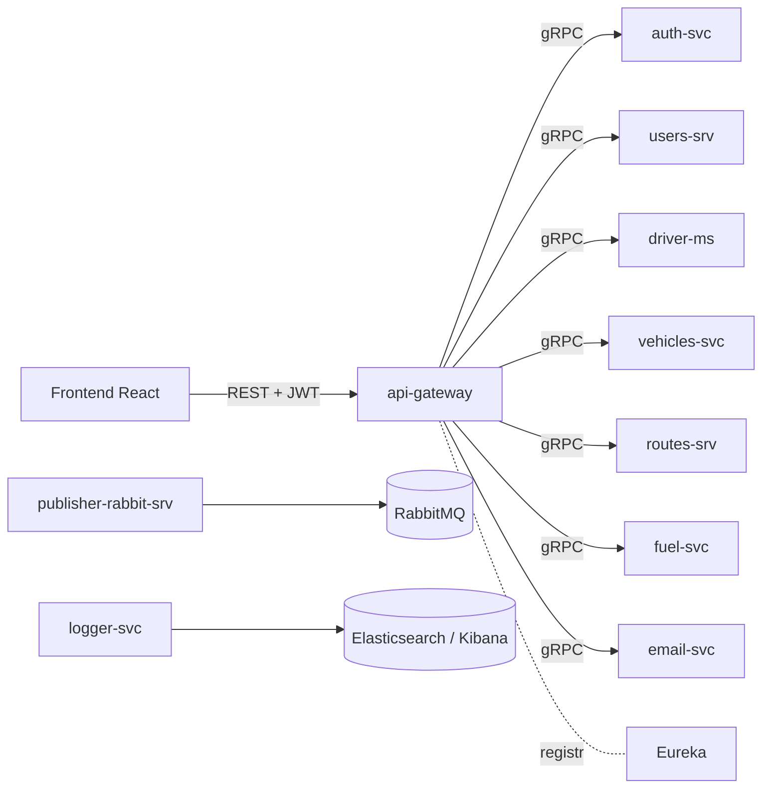

# Distributed Gasoline System · Backend

Backend de una plataforma para gestionar una flota de transporte: vehículos, conductores y licencias, rutas, viajes y consumo de combustible. Está dividido en microservicios NestJS que se comunican por gRPC detrás de un API Gateway.

Frontend: [Distributed-Gasoline-System-Frontend](https://github.com/JoelBonillaG/Distributed-Gasoline-System-Frontend)

## Arquitectura



| Servicio | Responsabilidad |
|---|---|
| `api-gateway` | Punto de entrada REST, validación de JWT y llamadas gRPC a los servicios |
| `auth-svc` | Inicio de sesión, tokens y roles |
| `users-srv` | Usuarios del sistema |
| `driver-ms` | Conductores, licencias y tipos de licencia |
| `vehicles-svc` | Modelos y unidades de vehículos, disponibilidad |
| `routes-srv` | Rutas y viajes |
| `fuel-svc` | Registros de combustible, estimado frente a real, reportes |
| `email-svc` | Envío de correos |
| `logger-svc` | Logs centralizados hacia Elasticsearch |
| `publisher-rabbit-srv` | Publicación de eventos en RabbitMQ |

- **Contratos:** los `.proto` de todos los servicios están en `protos/`.
- **Datos:** cada servicio tiene su propia base PostgreSQL (Prisma o TypeORM).
- **Descubrimiento:** los servicios se registran en Eureka.
- **Despliegue:** imágenes construidas con GitHub Actions y guías para Azure (AKS) en `deploy/azure/`.

## Ejecutar en local

Requisitos: Node.js 18+, npm y Docker.

```bash
npm install            # instala todos los servicios (workspaces)
npm run setup          # levanta Eureka y las bases, y prepara Prisma
npm run dev            # infraestructura + todos los servicios
# o una versión mínima sin RabbitMQ ni logs:
npm run dev:basic
```

El gateway queda en `http://localhost:8080` y Eureka en `http://localhost:8761`. Las variables de cada servicio están documentadas en [`services/README-ENV.md`](services/README-ENV.md).

| Script | Qué hace |
|---|---|
| `npm run infra:up` / `infra:down` | Levanta o baja Eureka y las bases de datos |
| `npm run dev:<servicio>` | Inicia un solo servicio (`gw`, `auth`, `users`, `drivers`, `vehicles`, `routes`, `fuel`, `email`, `logger`, `publisher`) |
| `npm run docker:up` | Levanta todo con Docker Compose |

## Endpoints principales (vía gateway)

| Método | Ruta | Descripción |
|---|---|---|
| `GET` / `POST` | `/drivers` | Listar y crear conductores |
| `GET` / `PUT` / `DELETE` | `/drivers/:id` | Consultar, actualizar o eliminar un conductor |
| `GET` | `/drivers/:id/can-drive/:licenseTypeId` | ¿Puede el conductor manejar con ese tipo de licencia? |
| `POST` | `/drivers/:driverId/licenses` | Registrar una licencia |

Las rutas de vehículos, rutas, viajes y combustible siguen el mismo patrón; cada servicio documenta las suyas.

## Equipo

DavidJosueP2 · JoelBonillaG · DRTX2 · JosueGarciaAbata
